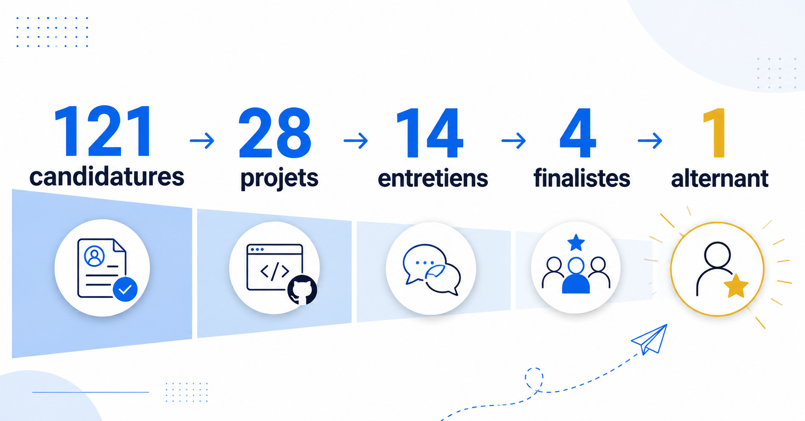

Cette année, nous avons ouvert un poste en alternance autour du développement logiciel et de la 3D sous Unreal Engine.
Et comme souvent avec les offres d’alternance, les candidatures sont arrivées vite. Très vite. **En cinq jours, nous
avions reçu 121 candidatures.**

Au début, j’ai commencé assez classiquement à regarder les CV. Mais pour recruter un profil débutant, je trouve que ce
n’est pas toujours une très bonne source d’information. Et surtout, nous recrutons un alternant. L’objectif n’est pas de
trouver la personne qui a déjà 5 ans d’expérience avec Unreal Engine.

J’ai donc assez rapidement arrêté de passer du temps sur les CV pour réfléchir à un test technique. L’objectif était
double : avoir quelque chose de plus concret qu’un CV pour évaluer les candidats, mais aussi filtrer les personnes qui
avaient postulé sans vraiment lire l’offre.

## Un test technique, même à l’heure de l’IA

Chaque candidat a donc reçu un email avec un énoncé. Pour le résumer, il fallait réaliser un petit projet sous Unreal
Engine, répondre à quelques demandes simples puis publier le résultat sur GitHub avec un README.

Le test devait permettre d’observer plusieurs choses :

* la capacité à comprendre et suivre une demande
* l’autonomie face à un outil pas forcément complètement maîtrisé
* la manière de structurer un petit projet
* l’utilisation de Git et GitHub

À l’ère de l’IA, certains me diront que les tests techniques n’ont plus vraiment de sens. Je ne suis pas complètement
d’accord. Oui, demander à quelqu’un de coder un algorithme que ChatGPT peut générer en 15 secondes n’a probablement plus
beaucoup d’intérêt. Mais ici le test était un peu plus complet.

Il fallait avoir installé Unreal Engine sur son PC, utiliser la bonne version, comprendre un énoncé, réaliser le projet,
utiliser Git et publier quelque chose de propre sur GitHub. Et rien que ça permet déjà de vérifier quelques bases qu’un
étudiant en développement devrait, à mon avis, maîtriser.

J’ai déjà rencontré en entretien des développeurs qui ne connaissaient pas GitHub. Donc ce n’est malheureusement pas
aussi évident qu’on pourrait le penser :) Mais surtout, le projet nous donnait ensuite une base concrète pour discuter
pendant l’entretien.

## 28 projets à tester

Sur les 121 candidatures, **28 personnes m’ont retourné un projet**. Habituellement, quand je propose ce genre
d’exercice, j’ai plutôt autour de 10 % de réponses. J’ai donc été assez surpris par le nombre de retours. Et forcément,
ça m’a aussi généré un peu plus de travail que prévu.

J’ai commencé par télécharger et lancer les 28 projets sur mon poste. Je voulais simplement vérifier quelques points de
base : est-ce que le candidat avait utilisé la version d’Unreal demandée ? Est-ce que le projet compilait ? Est-ce que
les instructions avaient été respectées ? Cette première étape a déjà permis d’éliminer certaines propositions.

Par exemple, un candidat avait mis sur GitHub… un fichier ZIP contenant son projet. Sans README. D’autres avaient bien
créé un dépôt GitHub mais m’avaient envoyé le README séparément par email.

Ça peut sembler anecdotique, mais suivre une consigne fait aussi partie du test. Si on demande de fournir un projet sur
GitHub avec un README, le README doit être sur GitHub.

## Un agent IA pour analyser les projets

Il me restait quand même pas mal de projets à comparer. J’ai donc créé un petit agent IA chargé de scanner l’ensemble
des repositories et de comparer les choix techniques.

L’objectif n’était pas de laisser une IA choisir notre alternant. Mais plutôt de m’aider à relever des différences entre
les projets et à avoir une première grille de lecture homogène.

Je lui ai par exemple demandé de regarder :

* le nommage des classes
* la structure du projet
* la qualité du `.gitignore`
* la présence éventuelle de binaires dans le repository
* les choix techniques réalisés pour répondre à l’exercice

Et cette vérification a été assez intéressante. Elle m’a permis de détecter cinq ou six candidats qui avaient simplement
publié le projet du tutoriel Unreal quasiment sans aucune modification.

À la fin de cette étape, il restait **14 candidats avec un projet que je considérais acceptable**.

## 14 entretiens de 30 minutes

J’ai décidé de rencontrer les 14. Ça représente du temps, mais ça me semblait normal. Ils avaient eux-mêmes pris du
temps pour faire l’exercice et nous envoyer un projet. Je trouvais donc normal de leur consacrer au moins 30 minutes.

Ces premiers entretiens n’étaient pas vraiment des entretiens techniques. Nous parlions de leur parcours, de leur
recherche d’alternance et surtout de ce qu’ils avaient pensé de l’exercice. Mais j’avais aussi quelques questions assez
simples.

### Savez-vous où est Lannion ?

La question peut sembler étrange pour un entretien de développeur :) Mais elle est finalement assez importante. Quand un
étudiant fait ses études à Marseille, Lyon ou Paris et postule pour une alternance à Lannion, je veux simplement savoir
s’il s’est posé la question de la faisabilité. Venir vivre en Bretagne pendant plusieurs années n’est pas complètement
anodin.

Je ne cherche évidemment pas quelqu’un qui connaît déjà les horaires du TER Guingamp-Lannion, mais au moins quelqu’un
qui a regardé où se trouve l’entreprise avant l’entretien.

### Qu’avez-vous compris du sujet de l’alternance ?

C’était probablement la question la plus importante. Et pourtant, plus de la moitié des candidats avaient beaucoup de
mal à y répondre.

L’objectif du poste était pourtant décrit dans l’offre. Je ne demandais pas une analyse technique détaillée. Je voulais
simplement savoir si le sujet les intéressait vraiment et s’ils avaient essayé de comprendre sur quoi ils allaient
travailler.

### Avez-vous des questions ?

C’est une question très classique. Pourtant, le nombre de candidats qui n’avaient absolument aucune question m’a
vraiment étonné.

Après avoir lu une offre, fait un exercice technique et passé 20 ou 30 minutes à parler avec le responsable de l’équipe,
ne rien avoir à demander me semble difficile. Une question sur l’entreprise, l’équipe, le projet, Unreal, les méthodes
de développement, le rythme de l’alternance… peu importe. Mais avoir quelques questions montre au minimum qu’on s’est
projeté dans le poste et que l'on a préparé .

## De 121 candidats à 4

Sur les 14 candidats rencontrés, **8 sont réellement sortis du lot**. C’est à ce moment-là que j’ai commencé à échanger
avec les personnes de l’équipe que le futur alternant allait rejoindre.

Nous avons repris les projets, mes notes d’entretien et les différents profils pour finalement en présélectionner
quatre. Ces quatre candidats ont ensuite passé un entretien d’environ une heure, beaucoup plus classique, avec plusieurs
personnes de l’équipe.

Et à ce stade, les différences techniques entre eux n’étaient finalement plus le critère principal.

## La technique ne fait pas tout

Tous les candidats arrivés jusque-là avaient déjà démontré qu’ils étaient capables de réaliser un petit projet
technique. Bien sûr, certains avaient produit quelque chose de plus propre ou de plus avancé que d’autres.

Mais nous recrutons un alternant. S’il maîtrise déjà parfaitement Unreal, le C++, Git, l’architecture logicielle et tout
le reste, il n’a probablement plus grand-chose à apprendre chez nous :)

Ce que nous cherchions surtout, c’était quelqu’un capable d’apprendre. Quelqu’un de curieux, qui pose des questions, qui
cherche quand il ne sait pas faire quelque chose et avec qui l’équipe aura envie de travailler pendant plusieurs années.

La motivation pour le sujet est également importante. Un très bon développeur qui n’a aucun intérêt pour le projet sera
probablement un moins bon choix qu’un candidat un peu moins expérimenté mais qui a réellement envie de comprendre le
domaine et de progresser.

Et enfin il y a le relationnel. Un alternant va passer beaucoup de temps avec son tuteur et avec l’équipe. La capacité à
communiquer, à expliquer un problème ou simplement à demander de l’aide est donc essentielle.

C’est probablement le principal enseignement de ce recrutement :

**le candidat techniquement le plus fort n’est pas forcément celui que l’on souhaite recruter.**

## Et finalement…

Après 121 candidatures, 28 projets Unreal, 14 premiers entretiens et 4 entretiens finaux, nous avons finalement
sélectionné notre futur alternant.

Le processus m’a demandé plus de temps que prévu, notamment à cause du nombre assez élevé de personnes ayant réellement
fait le test. Mais je préfère largement cette méthode à une sélection uniquement basée sur les CV. Elle permet de donner leur chance à des profils qui ne seraient peut-être pas ressortis sur le papier et surtout d’avoir
beaucoup plus d’éléments concrets pour discuter avec eux.

Le test technique n’était donc finalement pas vraiment là pour savoir qui était le meilleur développeur. Il permettait
surtout de voir qui avait lu la consigne, qui était capable de chercher, de produire quelque chose et de nous donner
matière à discuter. Et pour recruter un alternant, c’est finalement ce qui m’intéresse le plus.

**Je ne cherche pas un développeur déjà parfaitement formé. Je cherche quelqu’un avec qui nous avons envie de travailler
et que nous pensons pouvoir faire progresser.**

## Bonus : pour les courageux étudiants qui ont lu jusqu’à la fin !

Si vous êtes étudiant et que vous avez eu le courage de lire jusqu’ici, voici quand même trois petits conseils tirés de
cette expérience.

**Lisez vraiment les énoncés.** Ça semble évident, mais une partie des candidats perdent des points simplement parce
qu’ils ne respectent pas les consignes. Si on vous demande un projet sur GitHub avec un README, mettez le README sur
GitHub 

**Testez ce que vous envoyez.** Une fois votre projet terminé, faites un `git clone` dans un répertoire complètement
vierge et essayez de le relancer. C’est le moyen le plus simple de découvrir qu’un fichier important n’a pas été commité
ou que votre projet dépend de quelque chose qui n’existe que sur votre poste.

**Préparez un minimum votre entretien.** Pas besoin d’apprendre par cœur le site web de l’entreprise ou de préparer 50
questions. Mais relisez l’offre, essayez de comprendre le sujet et arrivez avec deux ou trois questions. Quand on vous
demande à la fin "Avez-vous des questions ?", répondre systématiquement "non" n’est probablement pas la meilleure
façon de montrer votre intérêt pour le poste.

